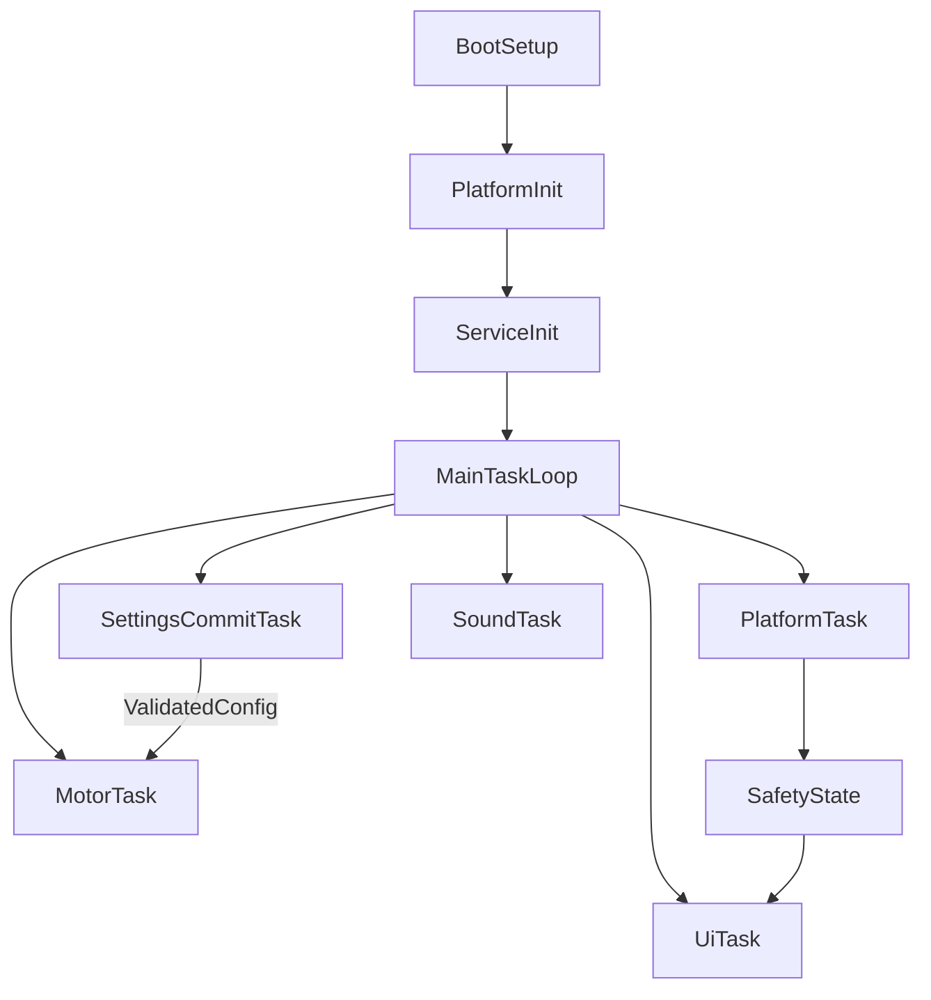

<!-- f6282e27-225a-47b9-86b6-012e9df2304a -->
---
todos:
  - id: "lifetime-policy"
    content: "Refactor allocation ownership and eliminate re-init leaks (especially TMC driver lifecycle)."
    status: pending
  - id: "pwm-state-fix"
    content: "Fix pico PWM slice/channel initialization and remove variable shadowing hazards."
    status: pending
  - id: "timing-hardening"
    content: "Make all cycle timers overflow-safe and validate menu-derived timing inputs."
    status: pending
  - id: "structure-cleanup"
    content: "Consolidate duplicate re-init callbacks and add consistent debug/log gating."
    status: pending
  - id: "serial-security"
    content: "Harden screen capture and serial behavior for production-safe operation."
    status: pending
  - id: "verification-gates"
    content: "Define static checks and soak-test checklist for long-run firmware quality."
    status: pending
isProject: false
---
# Firmware Code Quality Cleanup Plan

## Objectives
- Reduce long-run instability risk in an always-on firmware loop.
- Remove leak-prone allocation patterns and undefined-behavior hazards.
- Improve maintainability by separating concerns and standardizing patterns.
- Harden debug/serial features to reduce accidental data exposure or denial-of-service behavior.

## Key Findings Driving This Plan
- Heap allocations are used for global long-lived services and re-initialized subsystems; most are never freed (acceptable for one-time boot objects, unsafe for repeated re-init paths).
- `MotorControl::initMotionController()` allocates a new driver each call without reclaiming previous instance, so settings changes can leak heap over time.
- PWM state in `PicoPlatform` appears inconsistent: `initializePlatform()` uses local `slice`/`channel` variables while periodic updates reference class fields, creating uninitialized-state risk.
- Timing uses direct `millis() >= end` comparisons and additive arithmetic; overflow-safe subtraction patterns are not consistently applied.
- Runtime modules are tightly coupled through globals and direct callbacks, reducing testability and increasing hidden side effects.
- Serial-heavy debug and optional screen capture path can block the loop and expose screen data without explicit runtime gating beyond a pin check.

## Implementation Plan

### 1) Memory Lifetime and Allocation Safety
- Refactor boot-time singletons in `src/KiwiBoardFirmware_main.cpp` from raw `new` pointers to static/global instances or explicit ownership wrappers suited to embedded constraints.
- In `src/motorControl.cpp`, make TMC driver allocation idempotent:
  - either allocate once and reconfigure,
  - or safely destroy/replace previous instance when reinitializing.
- Add lightweight allocation policy comments in `src/KiwiBoardFirmware_main.cpp` and `src/motorControl.h` documenting what is intentionally process-lifetime vs. reconfigurable.
- Keep generated/plugin files untouched unless a thin wrapper can centralize ownership behavior.

### 2) Correctness and Undefined-Behavior Fixes
- Fix PWM member initialization in `src/picoPlatform.cpp`/`src/picoPlatform.h` so stored `slice` and `channel` are the same fields used by periodic updates.
- Remove ambiguous shadowed names (global/local/member collisions) for hardware state variables.
- Normalize state initialization for control structs (`MotorControl::MOTOR_STATE`, sounder tone state) to explicit defaults in constructors.

### 3) Timing and Long-Uptime Robustness
- Replace vulnerable absolute-time comparisons with overflow-safe elapsed-time checks in:
  - `src/motorControl.cpp` (`run_end` checks),
  - `src/picoPlatform.cpp` (cooldown/preheat checks).
- Promote timing arithmetic to explicit unsigned-width types and constants (`UL` suffix, helper wrappers) to prevent unintended signed math.
- Add sanity guards around menu-derived durations/speeds before conversion to milliseconds.

### 4) Bad Practice and Structural Cleanup
- Reduce repeated controller re-init logic (`GlobalScalerChanged`, `iRunChanged`, `stealthChopChange`) into a single helper in `src/KiwiBoardFirmware_main.cpp`.
- Gate verbose `Serial.println` instrumentation behind compile-time debug macros across `src/EncoderShim.cpp`, `src/motorControl.cpp`, `src/picoPlatform.cpp`, `src/Sounder.cpp`, `src/MenuChangeObserver.cpp`.
- Remove dead/commented blocks or convert to tracked TODOs with rationale.
- Clarify generated-vs-manual boundaries (keep `src/KiwiBoardFirmware_menu.cpp` as generated, move custom behavior to non-generated units).

### 5) Security and Safety Hardening
- For `SCREENCAP` path (`src/screenServer.cpp`, `src/KiwiBoardFirmware_main.cpp`), add explicit runtime guardrails:
  - optional compile-time disable by default in production,
  - stricter trigger policy (e.g., long-hold or maintenance mode),
  - clear timeout/fail-fast behavior to avoid prolonged loop blocking.
- Add bounds/validation for externally-influenced runtime parameters before applying hardware actions (speed, timing, backlight).
- Review serial output for sensitive operational leakage and reduce in production profiles.

### 6) Verification and Quality Gates
- Add a host-side static-analysis/lint target (or CI step) for shadowing, unchecked arithmetic, and allocation diagnostics.
- Add a minimal firmware soak test checklist:
  - repeated menu setting changes,
  - repeated start/stop cycles,
  - preheat/cooldown transitions,
  - long-run stability with serial/debug disabled.
- Add lightweight runtime assertions/log counters for state transitions (non-fatal in release builds).

## Suggested Architecture Direction

## Primary Files to Touch
- `src/KiwiBoardFirmware_main.cpp`
- `src/motorControl.h`
- `src/motorControl.cpp`
- `src/picoPlatform.h`
- `src/picoPlatform.cpp`
- `src/EncoderShim.cpp`
- `src/Sounder.cpp`
- `src/MenuChangeObserver.cpp`
- `src/screenServer.cpp` (and `src/screenServer.h` if policy flags are added)

## Out of Scope (for this cleanup pass)
- Regenerating or manually editing generated tcMenu core file content unless necessary for API compatibility.
- UI redesign or feature additions unrelated to reliability/quality/security hardening.